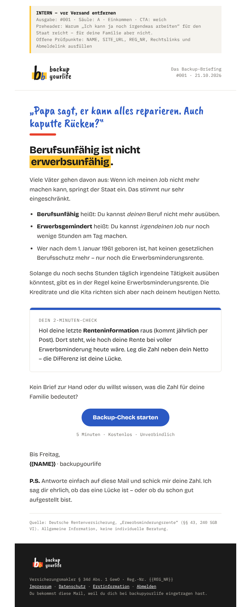

# Design-Handoff: backupyourlife Newsletter („Das Backup-Briefing“)

> Für Claude Cowork. Ergänzt `cowork-handoff-newsletter.md` (Inhalt & Ablauf).
> Dieses Dokument regelt **nur das Aussehen** jeder Ausgabe.
> Grundlage: Website-Designsystem `design_handoff_backupyourlife_website/DESIGN.md` und Logo-Regeln `logo/LOGO.md`, übersetzt auf E-Mail.

---

## 0. Kurzfassung für Cowork

1. Nimm **`newsletter-design/template.html`** als Vorlage. Baue keine eigene Struktur.
2. Ersetze nur die `{{PLATZHALTER}}` (Liste in Abschnitt 7). Struktur, Reihenfolge und Inline-Styles bleiben unverändert.
3. Lege das Ergebnis als `htmlBody` in den Gmail-Entwurf. Zusätzlich eine Plain-Text-Version als `body`.
4. Referenz für eine fertige Ausgabe: **`newsletter-design/beispiel-001.html`**.

---

## 1. Konzept

- Gleiche Idee wie auf der Website: **zwei Stimmen, nie vermischt.**
  - **Kinderstimme:** ein Satz, handschriftlich, blau. Öffnet jede Ausgabe.
  - **Faktenstimme:** Headline, Text, Check und CTA. Sachlich, kräftig, gerade.
- Wachsmalfarben auf weißem Papier: **75 % Weiß · 15 % Bleistift · 10 % Farbe.**
- Eine Spalte, max. 600 px, kein Bild außer dem Logo. Die Mail soll wirken wie eine
  persönliche Nachricht mit Struktur, nicht wie ein Werbeprospekt.

## 2. Farben

| Token | Hex | Einsatz in der Mail |
|---|---|---|
| paper | `#FFFFFF` | Hintergrund, immer |
| pencil | `#1A1A1A` | Headline, fette Wörter, Footer-Fläche |
| body | `#3A3835` | Fließtext |
| muted | `#6B6862` | Labels, Datum, Quelle, Microcopy |
| line | `#E6E3DC` | Trennlinien, Card-Rahmen |
| crayon-sky | `#2B59C3` | Kinderstimme, CTA-Button, Links |
| crayon-red | `#E8412C` | Wachsstrich unter der Kinderstimme, Säule C |
| crayon-sun | `#FFC531` | Highlighter (Fläche hinter einem Wort), Säule B |

**Kontrastregeln (Pflicht):**
- Gelb nie als Textfarbe. Auf Gelb steht immer `#1A1A1A`.
- Rot nie für Fließtext oder Buttons.
- Weißer Text nur auf Blau (Button) oder Bleistift (Footer).
- Pro Ausgabe höchstens **zwei** Wachsfarben sichtbar (Blau ist immer dabei: Kinderstimme + Button).

## 3. Typografie (mit E-Mail-Fallbacks)

Gmail lädt **keine Web-Fonts**. Darum hat jede Schrift einen festen Fallback. Apple Mail und iOS zeigen die Originalschriften.

| Rolle | Schrift (Fallback) | Größe Desktop / Mobil | Stil |
|---|---|---|---|
| Kinderstimme | Caveat Brush (Segoe Print, Bradley Hand, Comic Sans MS, cursive) | 32 / 28 px | `#2B59C3`, Zeilenhöhe 1.1 |
| Headline (H1) | Bricolage Grotesque 800 (Helvetica Neue, Arial) | 28 / 24 px | `#1A1A1A`, −0.02em |
| Fließtext | Bricolage Grotesque 400 (Helvetica Neue, Arial) | 16 px | `#3A3835`, Zeilenhöhe 1.6 |
| Labels, Datum, Quelle, Footer | IBM Plex Mono (Menlo, Consolas, Courier New) | 11–12 px | `#6B6862` |
| Button | Bricolage Grotesque 800 | 16 px | weiß auf `#2B59C3` |

**Regeln:**
- Handschrift **nur** für den einen Kinder-Satz oben. Nie für Zahlen, Buttons, Signatur oder Fakten.
- Zahlen und Beträge in Fett (Faktenstimme) oder Plex Mono, nie in Handschrift.
- Max. **ein** Wort der Headline im gelben Highlighter:
  `Wort`

## 4. Aufbau (von oben nach unten)

| # | Block | Design | Inhalt (siehe Content-Handoff) |
|---|---|---|---|
| 0 | **Intern-Kopf** | grauer Kasten, gelber Rand links, Plex Mono 12 px | Ausgabe, Säule, CTA-Typ, Preheader, Prüfpunkte. **Vor Versand löschen** (zwischen `<!-- [INTERN] -->` und `<!-- [/INTERN] -->`). |
| 1 | **Header** | Logo links (120 px breit), rechts „Das Backup-Briefing · #NNN · Datum“ in Plex Mono, 1 px Linie unten | – |
| 2 | **Kinderstimme** | Handschrift blau, darunter roter Wachsstrich 72 × 6 px | 1 Satz, in „…“ |
| 3 | **Headline** | H1 Grotesk 800, ein Wort im Highlighter | max. 8 Wörter |
| 4 | **Text** | Absätze 16 px, optional eine Liste mit 2–4 Punkten, Schlüsselbegriffe fett in `#1A1A1A` | Der Punkt + Das Wissen |
| 5 | **2-Minuten-Check** | Card: 1 px Rahmen, Radius 6 px, oben 6 px Wachsstreifen in Säulenfarbe, Label in Plex Mono GROSS | Mini-Aufgabe |
| 6 | **CTA** | 1 Satz Überleitung, Pill-Button blau zentriert, Microcopy in Plex Mono darunter | genau ein CTA |
| 7 | **Signatur + P.S.** | Grotesk, Name fett | Gruß, Name, P.S. |
| 8 | **Quelle** | Linie oben, Plex Mono 11 px muted | Quelle + Hinweis |
| 9 | **Footer** | Fläche `#1A1A1A`, Logo dunkel 96 px, Plex Mono 11 px, Links weiß unterstrichen | Pflichtangaben, Abmelden |

## 5. Säulenfarbe (Wachsstreifen der Check-Card)

| Säule | `{{SAEULE_FARBE}}` |
|---|---|
| A · Einkommen | `#2B59C3` (Blau) |
| B · Gesundheit | `#FFC531` (Gelb) |
| C · Familie | `#E8412C` (Rot) |
| D · Ordnung & Alltag | `#1A1A1A` (Bleistift) |
| E · Mythen & Fragen | `#1A1A1A` (Bleistift) |
| F · Lebensereignisse | `#2B59C3` (Blau) |

Damit gibt es über die Wochen ein wiedererkennbares System, ohne dass die Mail bunt wird.

## 6. Buttons & Links

- **CTA-Button:** Pill (Radius 999 px), `#2B59C3`, weiße Schrift 800, Padding 16 × 30 px, zentriert.
  Als Tabellenzelle gebaut (`bgcolor` + `<a>`), damit er auch in Outlook ein Button bleibt.
- **Button-Texte** (einheitlich wie auf der Website):
  - weicher CTA: **„Backup-Check starten“** – Microcopy: *5 Minuten · Kostenlos · Unverbindlich*
  - klarer CTA: **„Gespräch buchen (20 Min.)“** – Microcopy: *Kostenlos · Unverbindlich · Kein Abschlusszwang*
- **Links im Text:** `#2B59C3`, unterstrichen. Max. ein Link im Fließtext.
- Rot nie als Button.

## 7. Platzhalter in `template.html`

| Platzhalter | Inhalt | Beispiel |
|---|---|---|
| `{{BETREFF}}` | Betreff ohne Präfix | Berufsunfähig ≠ erwerbsunfähig |
| `{{PREHEADER}}` | max. 90 Zeichen | Warum „Ich kann ja noch …“ … |
| `{{AUSGABE_NR}}` | 3-stellig | 001 |
| `{{DATUM}}` | TT.MM.JJJJ | 21.10.2026 |
| `{{SAEULE}}`, `{{CTA_TYP}}`, `{{PRUEFPUNKTE}}` | nur Intern-Kopf | A · Einkommen / weich / … |
| `{{KINDERSTIMME}}` | 1 Satz in „…“ | „Papa sagt, er kann alles reparieren. …“ |
| `{{HEADLINE}}` | H1, ein Wort mit Highlighter-Span | Berufsunfähig ist nicht `<span…>`erwerbsunfähig``. |
| `{{TEXT_HTML}}` | `
` / `<ul>` mit `<li style="margin-bottom:8px;">` | siehe Beispiel |
| `{{SAEULE_FARBE}}` | Hex aus Abschnitt 5 | #2B59C3 |
| `{{CHECK_TEXT}}` | 2–3 Sätze, ein Begriff fett | … |
| `{{CTA_UEBERLEITUNG}}` | 1 Satz | Kein Brief zur Hand …? |
| `{{CTA_TEXT}}`, `{{CTA_LINK}}`, `{{CTA_MICROCOPY}}` | aus Abschnitt 6 | |
| `{{GRUSS}}` | „Bis Freitag,“ (Di-Ausgabe) / „Bis Dienstag,“ (Fr-Ausgabe) | |
| `{{NAME}}`, `{{PS}}`, `{{QUELLE}}` | | |
| `{{SITE_URL}}` | Website-Domain ohne `/` am Ende | https://backupyourlife.de |
| `{{LOGO_URL_LIGHT}}`, `{{LOGO_URL_DARK}}` | öffentliche URL der Logo-PNGs (nur Newsletter-Tool; im Gmail-Entwurf Text-Wortmarke) | {{SITE_URL}}/newsletter-design/assets/logo-light@2x.png |
| `{{REG_NR}}`, `{{LINK_IMPRESSUM}}`, `{{LINK_DATENSCHUTZ}}`, `{{LINK_ERSTINFO}}`, `{{UNSUBSCRIBE}}` | Pflichtangaben | |

**Logos:** liegen als PNG (2× Auflösung) in `newsletter-design/assets/` und werden über
`{{LOGO_URL_LIGHT}}` / `{{LOGO_URL_DARK}}` geladen (z. B. `{{SITE_URL}}/newsletter-design/assets/logo-light@2x.png`).
Gmail zeigt **keine SVGs** – nur diese PNGs verwenden. Solange `{{SITE_URL}}` nicht
feststeht, bleibt der Platzhalter stehen und wird im Intern-Kopf als Prüfpunkt geführt
(der `alt`-Text „backupyourlife“ erscheint dann statt des Logos).

## 8. Technische E-Mail-Regeln

**Gmail-Entwurf (wichtig, getestet):** Beim Anlegen eines Entwurfs über die Gmail-Schnittstelle
bereinigt Gmail das HTML:
- **Bilder werden entfernt** (auch eingebettete). → Im Entwurf die **Text-Wortmarke** aus dem
  Template verwenden (steht dort als Kommentar unter dem Logo, Header und Footer). Im
  Newsletter-Tool später wieder das Logo-Bild nutzen.
- **CSS-Kurzform `background:` wird entfernt.** → Farbflächen immer mit `bgcolor="…"` am `<td>`
  plus `background-color:…` setzen (so wie im Template). Für den Highlighter
  `background-color` am ``.
- **Links mit `{{…}}` werden unbrauchbar.** → Im Entwurf noch fehlende Links als
  `https://platzhalter.invalid/<name>` eintragen (z. B. `/backup-check`, `/impressum`) und im
  Intern-Kopf unter „Offene Prüfpunkte“ auflisten.
- HTML-Kommentare und der `<style>`-Block gehen verloren – nichts Wichtiges darin ablegen.

- Layout nur mit `<table role="presentation">`, alle Styles **inline**. Der `<style>`-Block im Template enthält nur Mobile-Anpassungen (optional, Gmail-App ignoriert ihn teils).
- Breite 600 px, Seitenabstand 40 px (mobil 20 px).
- Keine Schatten, keine Verläufe, keine Hintergrundbilder, kein JavaScript, keine Formulare.
- `transform`/Drehung der Handschrift wird in E-Mails nicht unterstützt – also weglassen.
- Bilder immer mit `width`, `height`, `alt`, `border:0`, `display:block`.
- Gesamtgröße HTML < 100 KB (Gmail kürzt sonst mit „Nachricht gekürzt“).
- Plain-Text-Version: gleiche Inhalte, CTA als „→ Text: Link“, keine Markdown-Zeichen.

## 9. Bildsprache (falls später Bilder dazukommen)

- Nur echte Kinderzeichnungen (mit Einwilligung) oder echte Alltagsfotos, max. 1 Bild pro Ausgabe, 520 px breit, Radius 6 px.
- Kinderzeichnungen im gestrichelten Rahmen (`2px dashed #BDB9AF`), Bildunterschrift in Plex Mono 12 px: `Mira, 6 · „Mein Papa und ich“`.
- Keine Stockfotos, keine Krankenhäuser, Rollstühle, Schirme, Schilde, Hände.

## 10. Do / Don’t

| Do | Don’t |
|---|---|
| Eine Kinderstimme oben, dann nur Faktenstimme | Handschrift für Zahlen, Buttons oder die Signatur |
| Weiß als dominante Fläche | Farbige Hintergründe außer Footer und Intern-Kopf |
| Ein Highlighter-Wort pro Headline | Mehrere gelbe Markierungen |
| Ein CTA-Button | Zwei Buttons oder Banner |
| Säulenfarbe nur im Card-Streifen | Säulenfarbe für Text oder Flächen |
| Kurze Absätze (max. 3 Zeilen am Handy) | Textwände, Schachtelsätze |

## 11. Abnahme-Checkliste pro Ausgabe

- [ ] Template unverändert genutzt, nur Platzhalter ersetzt
- [ ] Genau ein Kinder-Satz, ein Highlighter-Wort, ein Button
- [ ] Säulenfarbe passt zur Säule
- [ ] Kein Gelb als Text, kein Rot als Fließtext oder Button
- [ ] Alle Bilder mit Alt-Text, keine SVGs
- [ ] Intern-Kopf vorhanden und befüllt
- [ ] Footer mit Impressum, Datenschutz, Erstinformation, Abmelden

## Dateien

| Datei | Zweck |
|---|---|
| `template.html` | E-Mail-Vorlage mit Platzhaltern (Pflicht-Basis) |
| `beispiel-001.html` | Fertig befüllte Beispielausgabe #001 |
| `assets/logo-light@2x.png` | Logo für weißen Header |
| `assets/logo-dark@2x.png` | Logo für dunklen Footer |
| `preview-desktop.png`, `preview-mobile.png` | Vorschau (mit Original-Schriften gerendert) |
